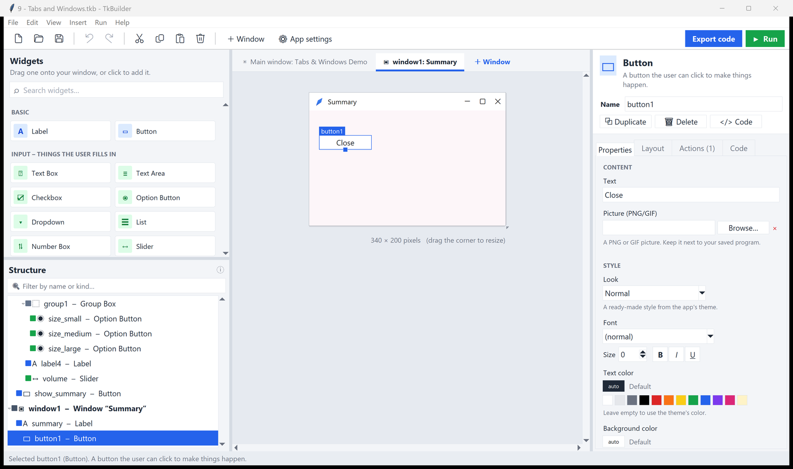
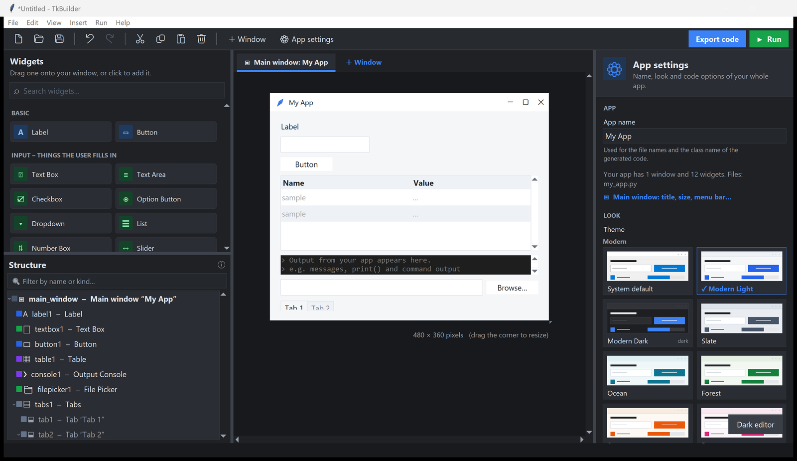

# TkBuilder

Build a Python desktop app (Tkinter) by drag and drop, connect it to your own
Python functions without writing GUI code, and export clean code that runs with
the standard library only.



**Highlights**

* Drag & drop widgets that snap into a grid, with live, theme-accurate preview
* 19 themes for your app (Modern Light/Dark, Slate, Nord, Dracula, ... plus all
  built-in ttk themes) and a light/dark editor
* No-code actions: show messages, set values, open windows, validate input...
* **Call your own Python functions** from buttons, map widgets to arguments and
  results, run them in the background
* Exports readable code: a regenerated `*_ui.py` plus **your** file that is
  never overwritten, with a simple `get` / `set` / `values()` API

## Start it

* Double-click **`Start TkBuilder.bat`** (or `TkBuilder.pyw`), or
* run `python app.py` in this folder (`python app.py my_project.tkb` opens a file).

Requires Python 3.8+ (Tkinter ships with Python on Windows). Nothing else to install.

The start page offers a blank project, your recent projects and **templates**:
Beam Calculator, Unit Converter, Live Sensor, Simulation Runner, Script Runner
and a few basics. Opening a template never changes the original.

## Design

1. **Drag** widgets from the left onto your window. Green guides show where it
   will snap in. A plain click adds the widget to the selected container.
2. **Click** a widget to edit it on the right: text, look, size, layout.
   Double-click a label or button to edit its text in place.
3. **⚙ App settings** picks the app's name and **theme**.
4. **Actions** make things happen without code: *When clicked → Show a
   message*, *Set the text of a widget*, *Open another window*… Write
   `{name_box}` in a text to use what the user typed in `name_box`.
5. **▶ Run** (F5) tries your app for real. Errors appear with their details.

Your design is a `.tkb` file. TkBuilder also keeps a recovery copy every
minute and offers it back if it ever closes unexpectedly.

## Connect your own code (engineers)

Keep your calculations in a normal Python file, e.g.

```python
# my_calcs.py
def beam_deflection(load_n: float, length_m: float = 2.0) -> dict:
    ...
    return {"deflection_mm": d, "moment_knm": m}
```

On a button, add the action **Call a Python function**, pick the file and the
function, and choose which widget gives each argument (*Create inputs for me*
builds a labelled input per argument). Choose where the result goes: one
widget, several widgets (tuple), or **widgets with matching names** (dict -
above, labels named `deflection_mm` and `moment_knm`). Long calculations run in
the background with a busy bar, so the window never freezes.

*Run a program / command* streams the output of any script or `.exe` into an
**Output Console**; a window **timer** repeats actions, e.g. to show live readings.

## Export

**Export code** (Ctrl+E) writes two files into the folder you choose:

| File | What it is |
|---|---|
| `my_app_ui.py` | The whole GUI. Regenerated on every export - don't edit it. |
| `my_app.py` | **Your** file, created once and never overwritten. Run this one. |

So you can keep redesigning the GUI without losing your code. Ticking
**"Also call my code"** on an event adds a method such as `on_calculate_clicked`
that you fill in in `my_app.py`:

```python
class MyApp(MyAppUI):
    def on_calculate_clicked(self):
        load = self.get("load_n")              # typed: float for a number box
        self.set("result", load * 2)           # thread-safe
        self.log("done")                       # to the Output Console
        self.run_in_background(slow_job, load, on_done=self.show_result, busy="progress1")
```

Other helpers: `values()` / `set_values({...})` for every input at once,
`on(name, "click", callback)`, `show_info/show_error/ask_yes_no`,
`open_window(name)`. Prefer one file? Choose *One file* under App settings ▸ Code.

With an export folder set, **▶ Run** regenerates the UI file there and runs
*your* file, so your own code runs too. Without a GUI:
`python app.py --export my_project.tkb [folder]`.

## Keyboard shortcuts

| Keys | Does |
|---|---|
| Ctrl+N / Ctrl+O / Ctrl+S | New (start page) / Open / Save |
| Ctrl+Z / Ctrl+Y | Undo / Redo |
| Ctrl+X / Ctrl+C / Ctrl+V | Cut / Copy / Paste widgets |
| Ctrl+D / Delete | Duplicate / Delete the selected widget |
| Arrow keys | Move the selected widget one cell |
| F5 / Shift+F5 | Run my app / Stop it |
| Ctrl+E | Export the code |
| F1 | All shortcuts |

View ▸ Dark editor switches TkBuilder itself to dark (your app's look is its theme).



## For developers

`SPEC.md` and `SPEC2.md` describe the architecture; `python test_codegen.py`
checks the code generator; `python make_examples.py` rebuilds the templates in
`examples/` (their functions live in `examples/backend/engineering.py`).

Preferences, recent files and the recovery copy live in `%APPDATA%\TkBuilder`
(override with `TKBUILDER_CONFIG_DIR`).

For automated runs set `TKBUILDER_NO_DIALOGS=1`: every pop-up answers itself
instantly (logged to stderr), TkBuilder's own windows close after
`TKBUILDER_DIALOG_TIMEOUT` seconds (default 8), the start page and recovery
offer are skipped, and preferences go to a temporary folder.

## License

MIT - see `LICENSE`.
